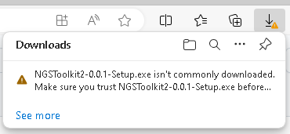
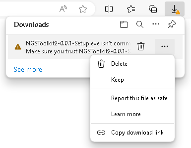
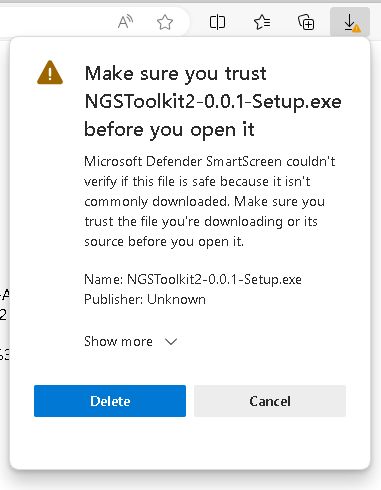
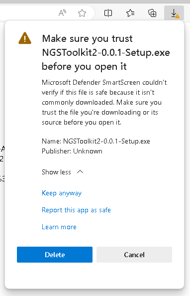
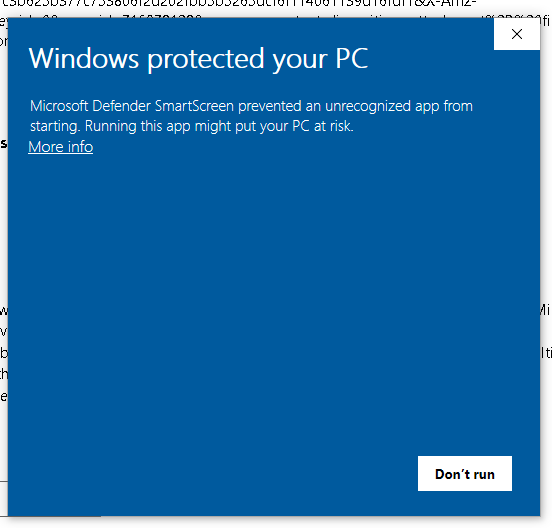
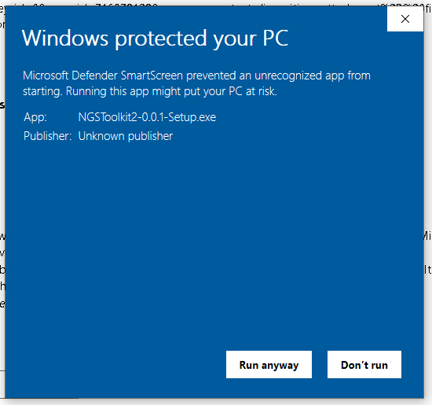

# NGSToolkit2
A desktop application for the analysis of 16S rRNA amplicon sequencing data using the TIC pipeline.

## Introduction


## Installation
### Windows
#### Preparations
Please install WSL2 as described [here](https://learn.microsoft.com/en-us/windows/wsl/install).
WSL2 is the underlying technology that allows us to execute the pipeline on Windows.

#### Download
Please download the installer from the Releases page.
You can find the latest version [here](https://github.com/TUM-Core-Facility-Microbiome/NGSToolkit2/releases/latest).

For Windows, please download the file ending with `Setup.exe`, e.g., `NGSToolkit2-0.0.1-Setup.exe` for version `v0.0.1`.

#### Setup
Microsoft might warn you that the installer is not commonly downloaded and could be dangerous.



Please click on the context menu (the 3 dots) that is showing up when you hover the entry and select `Keep`.



You might get another warning that the installer is not commonly downloaded and could be dangerous.



Please click on `Show more` and then on `Keep anyway`.



SmartScreen might warn you that the application is unrecognized.



Please click on `More info` and then on `Run anyway`.




### Linux
#### Preparations
Please install Docker Engine (not Docker Desktop) as described [here](https://docs.docker.com/engine/install/).
Docker Engine is the underlying technology that allows us to execute the pipeline in an isolated environment.

#### Download and installation
##### Debian-based distributions (e.g., Ubuntu)
Please download the `.deb` file from the Releases page.
You can find the latest version [here](https://github.com/TUM-Core-Facility-Microbiome/NGSToolkit2/releases/latest).

To install use Eddy, a graphical package manager, or the terminal:
```bash
sudo dpkg -i <path-to-deb-file>
```

## Usage

## Misc
